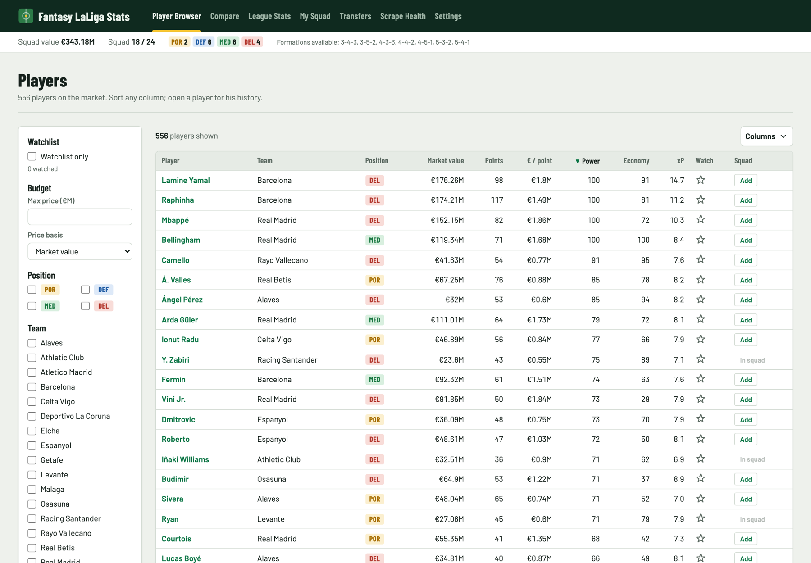
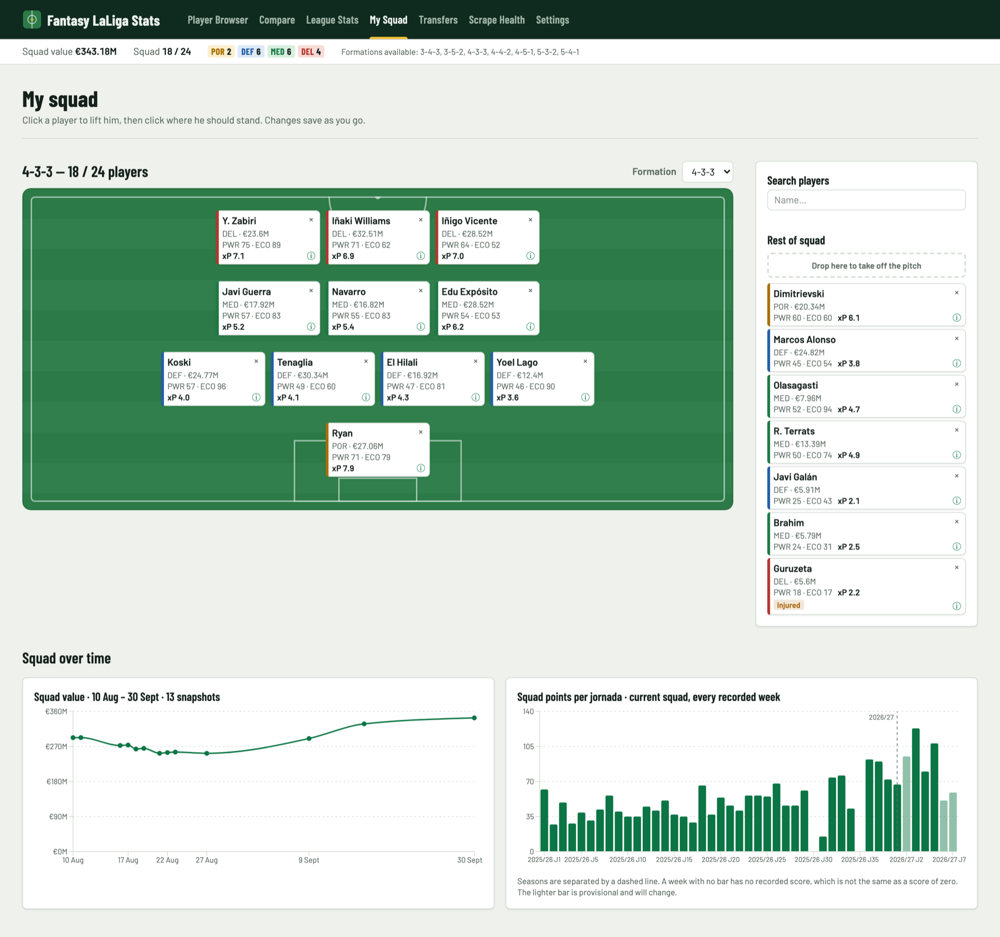
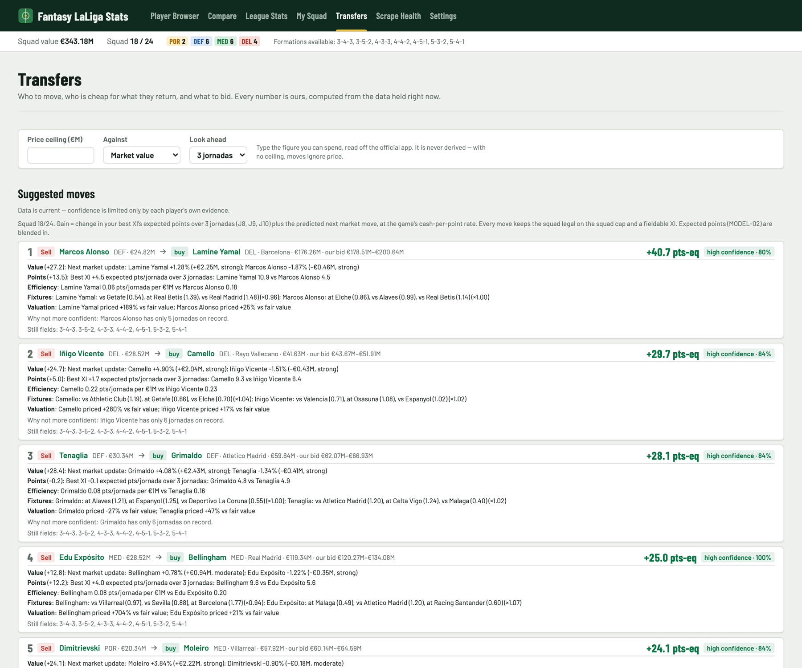
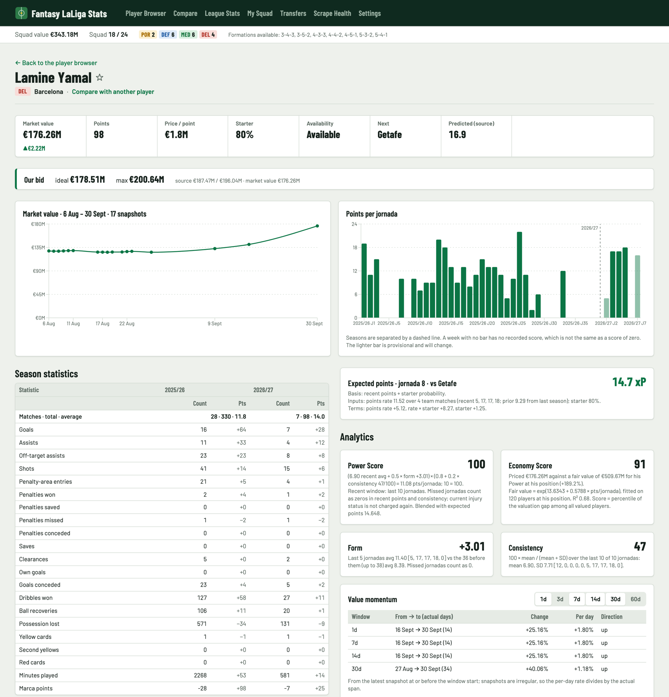
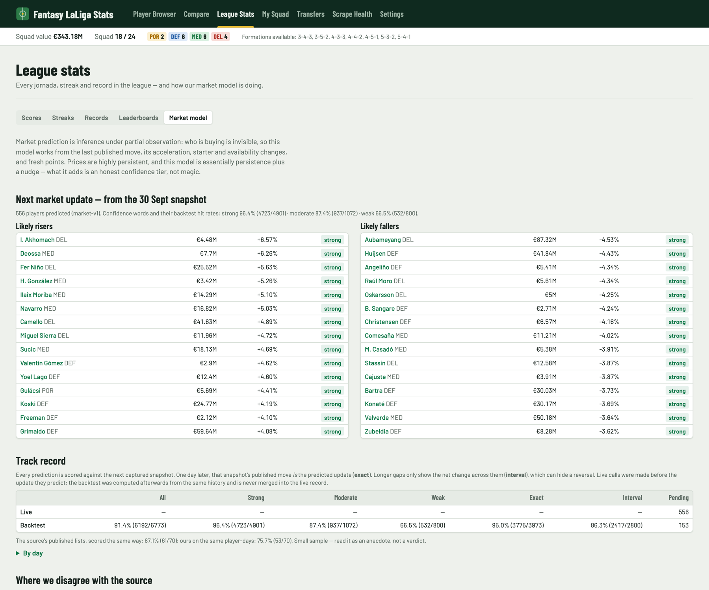
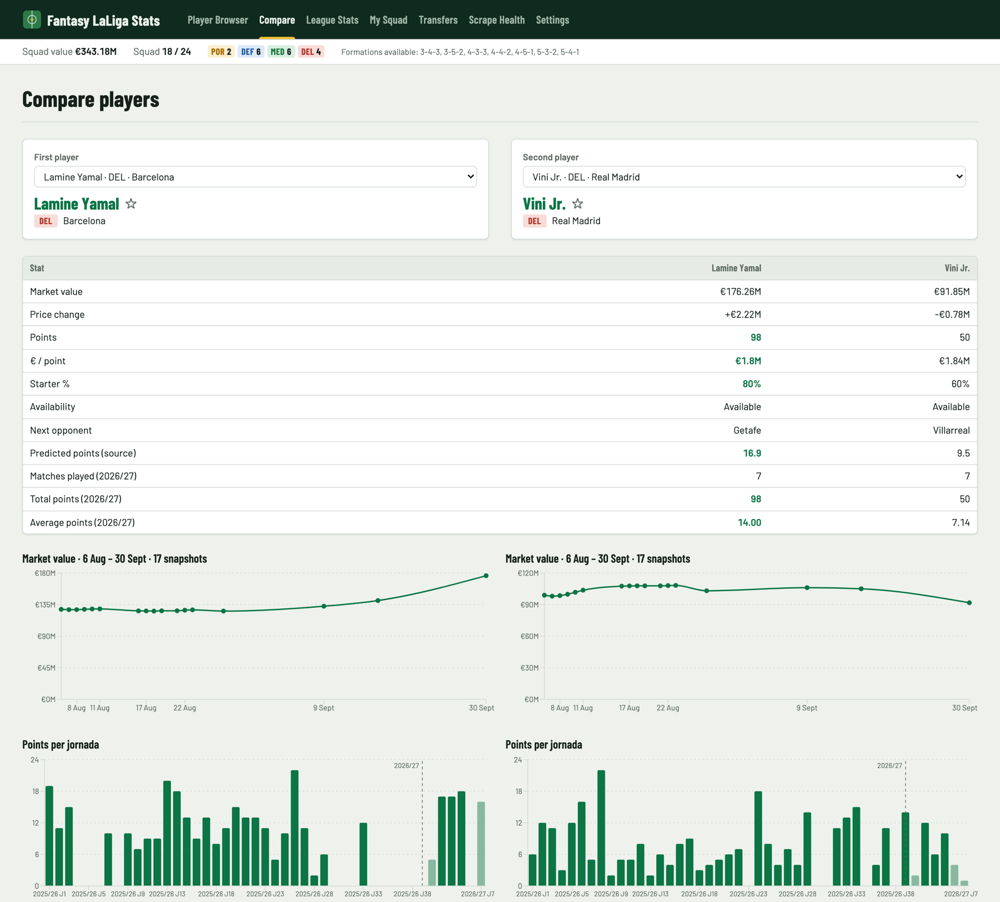
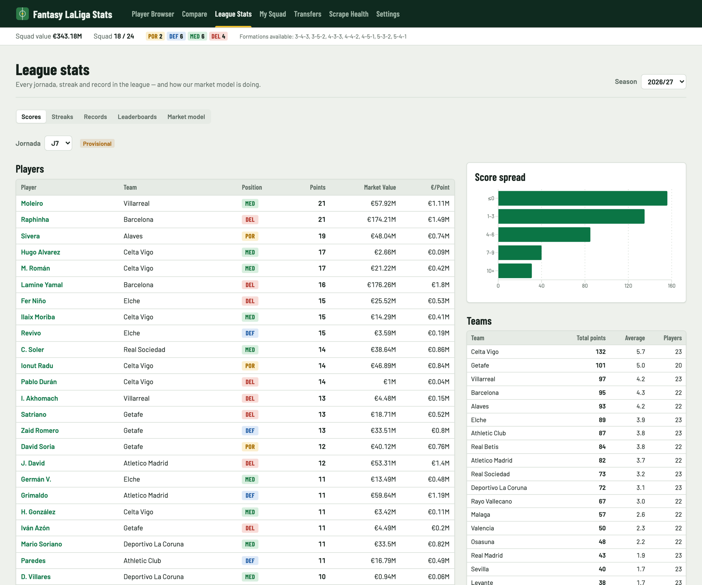
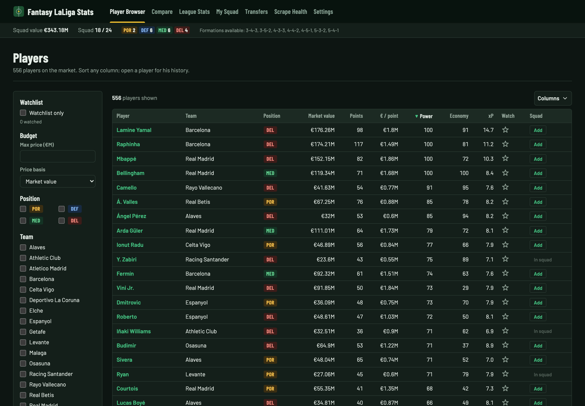
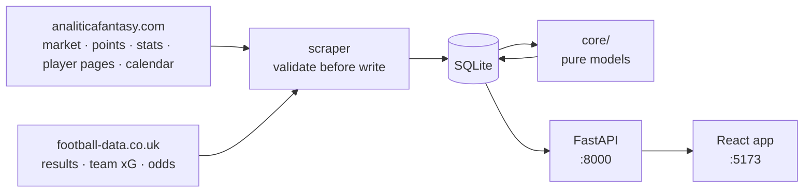

# Fantasy LaLiga Stats

A self-hosted analytics app for the Manager mode of [LaLiga Fantasy](https://fantasy.laliga.com).
It collects player, market and match data from public sources, runs its own models on top, and
answers one question: **which players should I hold, and which should I move?**


[](LICENSE)



Fantasy LaLiga Stats is a single-user app that runs on `127.0.0.1`. It has no accounts and no
cloud component, and it is not affiliated with LaLiga, DAZN or any of the data sources it reads.

## Contents

- [Features](#features)
- [Screenshots](#screenshots)
- [Architecture](#architecture)
- [Getting started](#getting-started)
- [Usage](#usage)
- [Configuration](#configuration)
- [Models and validation](#models-and-validation)
- [Development](#development)
- [Data sources](#data-sources)
- [License](#license)

## Features

**Player verdicts.** Every player gets one label (*Elite*, *Bargain*, *Rising*, *Fair price*,
*Overpriced*, *Avoid*, *Unproven* or *Unavailable*), up to two tags, a one-line reason and a
confidence level. A second line compares the player with your own squad: keep, sell, upgrade, or
which current starter they would replace. Labels are backtested, and any label that fails to beat
its baseline is switched off (see [Models and validation](#models-and-validation)).

**Player browser** (`/`). All ~560 players with market value, price change, points, our
**Power** rating, **Value** (points per euro against a replacement-level starter), a playing-time
class (*Nailed*, *Regular*, *Rotation*, *Fringe*), a 7-day price outlook, expected points (xP)
and the verdict. Sort and filter by any of them; one click narrows the table to the verdicts
worth acting on. Filters live in the URL, and a ★ watchlist filters the table to the players you
follow.

**Player page** (`/players/:id`). Market-value and points history, season statistics, and nine
metric cards. Each card shows the value, its rank within the player's position, what the metric
means, and a step-by-step table of how it was calculated.

**My squad** (`/squad`). Your squad on a pitch: click a player, then a slot. Reachable formations
update as the squad changes, the squad rules are enforced on the server, and squad value and
points are charted over time.

**Transfers** (`/transfers`). Ranked *sell → buy* suggestions with the signals behind each, the
best players per position, and our own ideal and maximum bids. Enter your cash once and it is
saved; each swap may also spend what its sale pays. Once you can field a full XI, suggestions
are swaps only; a plain signing is suggested only to fill a missing position. Every suggestion is
checked to leave the squad legal, and confidence drops when the data is stale.

**League stats** (`/stats`). Per-jornada scores and score distribution, team totals, streaks,
single-jornada records and season leaderboards for 24 statistics. The **Market model** tab lists
predicted risers and fallers, the models' live track record, and the verdict validation report.

**Compare** (`/compare`). Two players side by side, with the better value highlighted.

**Health** (`/health`). Every refresh and every dataset within it, with row counts, failures and
their reasons, plus per-player data coverage.

The interface follows the system light/dark setting and works down to phone width.

## Screenshots

*Taken with a demo squad.*

| | |
|---|---|
| **My squad**<br/> | **Transfers**<br/> |
| **Player page**<br/> | **Market model**<br/> |
| **Compare**<br/> | **League stats**<br/> |

<details>
<summary>Dark mode</summary>



</details>

## Architecture



- **Independent datasets.** A refresh runs each dataset separately. One failing source is
  recorded on its own and does not stop the others, and a malformed page is rejected rather than
  written.
- **Pure model code.** Everything in `core/` is free of I/O and unit-tested in isolation. The live
  app and the backtesting harness call the same functions.
- **Server-side rules.** Squad caps, quotas and formations come from
  [`docs/RULES-LALIGA-FANTASY.md`](docs/RULES-LALIGA-FANTASY.md) via
  `core/rules_data/laliga_fantasy.json`. The client only renders the server's decisions.
- **Migrations only.** The schema changes only through Alembic, and the test suite builds its
  database through the same migrations.

```
api/          FastAPI app and routes
core/         pure logic: parsing, validation, rules, analytics, models
storage/      SQLModel tables, repositories, model runners and backtests
scraper/      source adapters and the refresh / backfill entrypoints
migrations/   Alembic revisions
web/          React 19, Vite, TypeScript, TanStack Query/Table, Recharts, Tailwind v4
tests/        pytest suite (Vitest tests sit next to their components)
docs/         game rules and scraping policy
```

## Getting started

**Requirements:** Python 3.12+, [uv](https://docs.astral.sh/uv/), and Node.js 20.19+ or 22.12+.
Developed on macOS; Linux should work unchanged.

```bash
git clone https://github.com/ABO896/fantasy-laliga-stats.git
cd fantasy-laliga-stats

uv sync                               # Python dependencies
uv run playwright install chromium    # browser used for player pages
npm --prefix web install              # frontend dependencies

cp .env.example .env                  # defaults work as-is
uv run alembic upgrade head           # create the database

make dev                              # API on :8000, web app on :5173
```

Open <http://127.0.0.1:5173>. The database starts empty; use **Refresh now** in the banner, or
run `make scrape`. To seed the charts and models with history, backfill last season once:

```bash
make backfill                                                    # 2025/26 points per jornada
uv run python -m scraper.backfill --season 2025 --football-data  # 2025/26 results and odds
```

If the app reports that it cannot reach the API, start the backend on its own with `make api`.

## Usage

### Refreshing data

Data refreshes on demand rather than on a schedule. When data is stale the app shows a banner;
refresh from there, from the Health page, or from a terminal:

| Command | Refresh | What it fetches |
|---|---|---|
| `make scrape` | Quick | Market, points, season statistics, predictions, fixtures, results; then runs the models |
| `make scrape-mine` | Quick + my players | The above, plus the player pages of your squad and watchlist |
| `make scrape-full` | Complete | The above, plus every player page that is due, within a request budget |

Player pages supply per-match minutes and daily prices, which the playing-time class and the
verdict depend on. Until a player's page has been fetched, their verdict is *Unproven* or carries
low confidence; run a Complete refresh to fill them in.

Refresh controls stay disabled until a run finishes, show the step it is on, and reload every
page's data when it ends; only one refresh runs at a time. Within 36 hours of a jornada's first
kickoff, the banner also reminds you to refresh, because expected points are frozen when the
jornada locks.

### Updating

```bash
git pull
uv sync && npm --prefix web install
cp data/fantasy.db data/fantasy.db.backup-$(date +%Y%m%d)
uv run alembic upgrade head
```

Your squad, watchlist, settings and history live in `data/fantasy.db`, and your configuration in
`.env`. Both are git-ignored, so `git pull` never touches them. Migrations alter tables in place;
one only removes data when the feature it belongs to is removed, and its commit says so. The
backup covers that case.

## Configuration

Settings are read from `.env` (see [`.env.example`](.env.example)), with defaults for everything.

| Variable | Default | Purpose |
|---|---|---|
| `DB_PATH` | `./data/fantasy.db` | SQLite database file |
| `RAW_SNAPSHOT_ROOT` | `./data/raw_scrapes` | Raw HTML kept for debugging a bad scrape |
| `RAW_RETENTION_DAYS` | `7` | Days raw HTML is kept; purged on each refresh |
| `USER_AGENT` | identifies this project | Sent with every request |
| `FOOTBALL_DATA_ENABLED` | `true` | Set to `false` to skip football-data.co.uk |
| `API_HOST` / `API_PORT` | `127.0.0.1` / `8000` | Loopback only; do not bind to `0.0.0.0` |

League options, such as premium formations and the bench, are set in the app under **Settings**.

> **Testing against a copy of your database?** Point both `DB_PATH` and `RAW_SNAPSHOT_ROOT` at
> temporary locations. A refresh purges old raw HTML under `RAW_SNAPSHOT_ROOT` regardless of
> which database it writes to.

## Models and validation

The source site paywalls its own predictions, so the app builds its own and scores them against
what actually happened. Track records are shown in the app, not only here.

| Model | What it does | How it performs |
|---|---|---|
| **Power** | Points per team match, shrunk toward a prior and calibrated, times availability | Rank correlation with future points 0.43 in backtest (previous version 0.40) |
| **Value** | Points per euro against a replacement-level regular starter, over the next 3 jornadas | Input to the verdict; validated through it |
| **Playing time** | Start and play chance from minutes, adjusted for availability | Requires player-page data |
| **Expected points (xP)** | Per player, per jornada, from team-level odds, start chance and form | Against the source's prediction: MAE 2.40 vs 2.38, RMSE 3.34 vs 3.41, Spearman 0.54 vs 0.52 |
| **7-day price outlook** | Per-position ridge regression on daily prices, with an 80 % interval; drives the verdict, transfers and our bids | Scored at 7 days against a "repeat last week" baseline; backtest interval coverage 82 %. *Drop risk* (an expected move of −3 % or worse) is right 87 % of the time |
| **Verdict** | One label per player from the inputs above | Walk-forward backtest, below |

**Verdict validation** (33 dates, compared with eligible players in the same position):

| Label | Result | Status |
|---|---|---|
| Elite | +4.8 points over 3 jornadas (90 % CI 2.3 to 7.7) | On |
| Avoid | Scores +5.7 on its claim | On |
| Overpriced | +1.07 points per €M on its claim | On |
| Rising | +22.5 pp price change (CI 19.4 to 25.9), but plain 7-day momentum scores +27.8 | On, adds little over momentum yet |
| Bargain | Not yet scorable; needs 6+ matches and 3 finished jornadas | On, marked "not yet validated" |
| Sell high | Beats chance (+10.4) but loses to momentum (+15.1) | Off |
| Rotation risk | CI −5.1 to 19.9 includes zero | Off |

The evidence is still thin: only 14 of the 33 dates had a points outcome. Re-run the report as
the season progresses with `make verdict-report`; the result appears under Stats → Market model.

**Known limits.** There is no permitted source for per-player xG or xA, so xP works from
team-level data. Its opponent term needs bookmaker odds, which are often published only shortly
before a jornada. A results-based opponent model was tested as a fallback and not adopted: on
6,178 out-of-sample cases it did not measurably beat leaving the opponent out, and neither did
real odds. Market demand (who is buying whom) is not observable, so price models infer it from
proxies. Transfer-suggestion weights are set by hand and are not yet scored against outcomes.

To reproduce the xP backtest, or re-run the opponent-model check as results accrue:

```bash
uv run python -m storage.xp_backtest --db data/fantasy.db --fit
make xp-gate
```

## Development

```bash
make test                     # pytest and Vitest
uv run ruff check .           # lint
npm --prefix web run build    # type-check and production build
```

All three should pass before a change is merged. Tests never use the network. Parser tests run
against pages captured from the live sources, which are not redistributed here; on a fresh clone
they are skipped with the missing file named in the reason. See
[`tests/fixtures/README.md`](tests/fixtures/README.md) to capture your own.

A passing test suite does not mean your real database is migrated. After pulling a change that
adds a migration, back up the database and run `uv run alembic upgrade head`.

## Data sources

| Source | Used for |
|---|---|
| [analiticafantasy.com](https://www.analiticafantasy.com) | Players, market values, bids, jornada points, season statistics, per-player match data, predictions, fixtures |
| [football-data.co.uk](https://www.football-data.co.uk) | LaLiga results, team shots and xG, pre-match and closing odds |

Requests are made on demand, sequentially with jittered delays, within a per-run budget, and with
an identifying User-Agent. A 403, 429 or bot challenge stops that source for the rest of the run
and is never retried around. There is no proxy rotation or fingerprint spoofing. The full policy,
including each source's terms as this project reads them, is in
[`docs/SCRAPING-POLICY.md`](docs/SCRAPING-POLICY.md); read it before changing `scraper/`.

Scraped data stays on the machine that fetched it and is never committed to this repository. The
project is for personal, non-commercial use, and anyone running it is responsible for respecting
each source's terms.

Game rules are taken from the operator's own help centre and recorded in
[`docs/RULES-LALIGA-FANTASY.md`](docs/RULES-LALIGA-FANTASY.md).

## License

[MIT](LICENSE). The license covers the code only, not data fetched from the sources above, which
remains subject to each source's terms.
